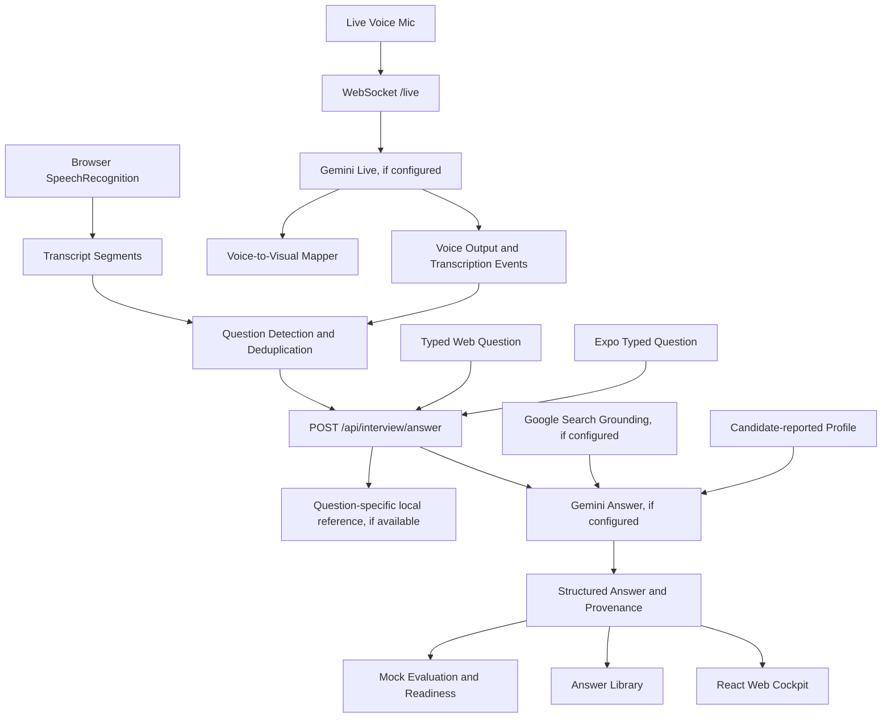

# 🍎 Applebee Interview Intelligence
### Your brain is a distributed system. Add a little observability.

<p align="center">
  <strong>Hear the question. Find the signal. Ship the answer.</strong>
</p>

<p align="center">
  An AI interview copilot for developers whose thoughts occasionally autoscale in the wrong direction.
</p>

<p align="center">
  
  
  
  
  
</p>

---

## 🎬 The problem: your brain just deployed to production

The interviewer asks:

> "How would you design a globally distributed, highly available API that can survive a tenfold traffic spike?"

Your brain's incident dashboard:

```text
CPU:       100% (no autoscaler configured)
Memory:    ??? GB (heap dump inconclusive)
Network:   Connection reset by confidence
Latency:   4–6 business days
Error:     SeniorEngineerException: answer not found in cache
```

Applebee helps turn that moment into a structured engineering response before your inner SRE starts a postmortem.

It can analyze questions, organize concise answers and talking points, suggest follow-ups, and map technical discussion to visual models. Microphone and AI features depend on browser support, permissions, and server configuration; see the verification notes below for the current boundaries.

Knowing the answer is one thing.

Explaining it clearly while someone silently evaluates your entire career is another. Especially when your brain has mistaken the whiteboard for a distributed cache.

## ⚡ Meet your interview copilot

<details>
<summary><strong>🧠 The Answer Engine — fewer paragraphs, more signal</strong></summary>

Every detected question can be organized into a practical answer structure:

- **The 5-second answer:** State the core solution first.
- **Talking points:** Three to five decisions, implementation details, and measurable considerations.
- **Trade-offs:** Explain what you gain, what you sacrifice, and why.
- **Deep dive:** Expand into protocols, failure modes, scaling strategies, and implementation details.
- **Likely follow-ups:** Prepare for the question behind the question.
- **Copy and save:** Reuse useful answers in your personal Answer Library.

Example question:

> How do you make an ASP.NET Core API resilient under heavy load?

```text
01  Keep application instances stateless.
02  Scale horizontally based on meaningful signals.
03  Use bounded timeouts, retries and circuit breakers.
04  Cache selectively; protect the database from overload.
05  Trace requests end-to-end and measure SLOs.
```

The goal isn't to memorize a paragraph. It's to understand the answer well enough to defend your decisions when the interviewer asks, "What happens when that dependency is down?" Naturally, it's always down in the follow-up.

</details>

<details>
<summary><strong>🎙️ Live Audio — finally, observability for the conversation</strong></summary>

The live voice integration is designed for bidirectional audio conversations with Gemini Live.

Reported capabilities include:

- Microphone permission handling.
- Live audio capture and streaming.
- Candidate and interviewer transcript attribution.
- Timestamped transcript segments.
- Spoken AI responses with streaming transcription.
- Voice persona selection.
- Interruption handling.
- Audio playback scheduling to reduce gaps.
- Voice-to-visual synchronization.

The reported audio configuration uses 16 kHz PCM input and 24 kHz PCM output.

**Latency budget:** An answer about Kubernetes should arrive before the conversation has moved on to compensation. That's a tight SLO, even for a small system.

</details>

<details>
<summary><strong>🏗️ Architecture Vision — boxes with a reason to exist</strong></summary>

Applebee's voice-to-visual engine maps recognized technical entities to architecture components and pathways.

Mention Azure API Management, Redis, Cosmos DB, or a circuit breaker, and the visualization layer can highlight relevant nodes and connections as the transcript arrives.

Supported visualization categories include:

- System architecture and service topology.
- Technology comparison matrices.
- Coding complexity.
- STAR behavioral responses.
- Troubleshooting and triage workflows.

The intent is to make abstract technical explanations easier to follow, recall, and discuss. A diagram is not production-ready merely because it contains enough arrows to qualify as a network map.

```text
                 ┌──────────────────┐
                 │  Client / Users  │
                 └────────┬─────────┘
                          │ HTTPS
                 ┌────────▼─────────┐
                 │ Azure API Mgmt   │
                 │ Auth / Throttling│
                 └────────┬─────────┘
                          │
                 ┌────────▼─────────┐
                 │ ASP.NET Core API │
                 │ Stateless        │
                 └───┬──────────┬───┘
                     │          │
              ┌──────▼───┐  ┌───▼──────────┐
              │ Redis    │  │ Azure SQL /  │
              │ Cache    │  │ Cosmos DB    │
              └──────────┘  └──────────────┘

                 ┌──────────────────┐
                 │ App Insights /   │
                 │ OpenTelemetry    │
                 └──────────────────┘
```

This is an illustrative architecture, not a claim that every service is deployed by the application.

</details>

<details>
<summary><strong>🔎 Google Search Grounding — receipts for confident answers</strong></summary>

The reported Gemini integration uses Google Search grounding to retrieve supporting information.

The interface is designed to expose:

- Executed search queries.
- Grounding result titles and URLs.
- Supporting documentation links.
- References from authoritative technical sources.

Useful documentation targets include Microsoft Learn, the Azure Architecture Center, OWASP, AWS documentation, Google Cloud documentation, and MDN.

Grounding improves traceability, but it does not guarantee correctness. A citation is evidence to inspect, not a hall pass from reading the docs. Check sources before relying on recommendations in an interview or production system.

</details>

<details>
<summary><strong>📱 Expo Go — your copilot can fit in your pocket</strong></summary>

The React Native mobile client is designed around quick answers and glanceable information.

Reported mobile capabilities:

- Microphone permission and audio session handling.
- Concise answers and talking points.
- Native architecture diagrams.
- Copilot, Transcript, Diagrams, and Profile navigation.
- Native answer sharing.
- A draggable floating widget.
- Live transcript and voice-synchronized architecture cards.

The web cockpit also includes a simulated phone companion, QR-code workflow, and Expo development-server launch instructions.

The simulator is a development aid. It does not, by itself, prove that the application has been installed or tested on a physical iOS or Android device.

</details>

<details>
<summary><strong>🎯 Mock Interviews — practice incidents with no pager</strong></summary>

The mock interviewer and Bar Raiser evaluator are designed to assess answers across four dimensions:

| Dimension | What it evaluates |
|---|---|
| Clarity & structure | Is the answer direct, organized, and easy to follow? |
| Technical depth | Can you explain the underlying mechanisms? |
| Trade-offs | Can you justify alternatives and constraints? |
| Production readiness | Have you considered reliability, security, and SLOs? |

The reported evaluator generates a score out of 100, identifies strengths, and suggests concrete improvements.

Use it to find weak spots before a real interview turns them into a live debugging exercise.

</details>

<details>
<summary><strong>📊 Readiness Analytics — measure the gaps, not the vibes</strong></summary>

The readiness dashboard is designed to track coverage across:

- System design.
- .NET and Azure.
- Coding.
- Cloud security.
- Behavioral leadership.

The objective is to identify high-impact revision areas and turn interview preparation into a repeatable process.

A readiness score is a practice metric, not a scientifically validated prediction of hiring success.

</details>

---

## 🖥️ The cockpit

The flagship experience is organized into three panels.

| Panel | Responsibility |
|---|---|
| 🎙️ Left | Live audio, transcript, timestamps, and answer selection |
| 🧠 Center | Detected question, quick answer, talking points, trade-offs, and deep dive |
| 🗺️ Right | Architecture diagrams, follow-up predictions, and source references |

The design principle: **show the useful signal first; put the rest behind a switch.** Even interfaces deserve a reasonable noise budget.

No 40-paragraph answer when five clear bullets will do.

No decorative architecture diagram that contradicts the explanation.

No pretending that a confident tone is the same thing as a correct answer.

---

## 🏛️ How it fits together



### Technology stack

| Layer | Technology |
|---|---|
| Web interface | React, TypeScript, Vite |
| AI reasoning | Gemini model integrations |
| Live audio | WebSocket bridge and Gemini Live API |
| Grounding | Gemini Google Search tool integration |
| Architecture visuals | Custom voice-to-visual mapping and diagram components |
| Mobile | React Native, Expo SDK 52, expo-av |
| Cloud knowledge | Microsoft Learn, Azure, AWS, OWASP, MDN and other documentation |
| Quality checks | npm test, TypeScript checking, Vite production build |

Exact dependencies, API identifiers, and supported model versions should be confirmed against the actual repository and current provider documentation before deployment.

---

## 🚀 Get it running

### Prerequisites

- Node.js and npm compatible with the root project's dependencies.
- A Google AI Studio API key for the Gemini integrations.
- Git.
- Expo Go for mobile development, where supported.
- A microphone and permission to use it.

Check the project's existing Node.js requirements before upgrading dependencies.

### 1. Clone the repository

```bash
git clone <YOUR_REPOSITORY_URL>
cd <YOUR_REPOSITORY_DIRECTORY>
```

### 2. Install the web dependencies

```bash
npm install
```

### 3. Configure environment variables

Inspect the existing server configuration and environment-variable names. Create a local `.env` file using the variable names the application actually expects.

Example template:

```dotenv
GEMINI_API_KEY=replace_with_your_own_key
```

This is an illustrative placeholder. Add any other required variables documented by the repository.

**Security rule:** keep API keys on the server. Do not commit `.env` files, expose secret keys in browser bundles, or embed privileged credentials in the mobile application.

### 4. Start the web application

```bash
npm run dev
```

Use the local URL printed by Vite.

### 5. Run the checks

```bash
npm test
npm run lint
npm run build
```

Check `package.json` for the actual script definitions. Here, `npm run lint` runs TypeScript, not a style linter. The name is aspirational; the compiler is not.

---

## 📲 Run the mobile client

From the repository root, start the Expo companion with:

```bash
./run-expo.sh
```

The launcher installs Expo dependencies when needed. Add Expo CLI options after the script name, such as `./run-expo.sh --tunnel`. See [README_EXPO_APP.md](README_EXPO_APP.md) for device connection and setup notes.

Then open the development project using Expo Go on a compatible device.

- **Android:** scan the development QR code using Expo Go.
- **iOS:** scan the QR code using the appropriate supported Expo workflow.

The development machine and mobile device generally need network connectivity to one another. Firewall settings, network isolation, and SDK compatibility can affect the connection.

### Important mobile setup notes

- The project report identifies Expo SDK 52, React Native 0.76.6, and expo-av ~15.0.1.
- `expo-av` is deprecated in newer Expo releases; verify the current migration guidance before upgrading.
- Check the actual installed package versions and native permission configuration.
- Test microphone access, background behavior, audio interruptions, and floating-widget positioning on physical devices.
- A working Expo development session is not the same as a signed production build.

---

## 🧪 Quality checks and verification

The current root checks are:

| Command | Current result |
|---|---|
| `npm test` | 14 application behavior tests passed |
| `npm run lint` | TypeScript check passed |
| `npm run build` | Vite production build passed |

The server was also smoke-tested without `GEMINI_API_KEY`: the C# polymorphism local reference returned a relevant, unverified answer; unsupported questions, search grounding, and Live Voice reported unavailable; ordinary transcript statements were not detected as questions; and local evaluation was labeled heuristic.

### What still needs real-world verification?

Passing unit tests is a useful milestone. It is not the finish line.

Before describing the product as production-ready, verify:

- Real Gemini answer generation, Google Search grounding, and Live Voice with a valid API key and provider-supported model identifiers.
- Browser microphone permissions and SpeechRecognition support on target browsers.
- API authentication, rate limits, retries, and failure handling.
- Search grounding responses and source-link validity.
- Physical-device Expo Go behavior; its current client records locally but does not transcribe or stream audio.
- Mobile network interruptions and microphone lifecycle cleanup.
- Accessibility, keyboard navigation, and responsive layouts.
- Privacy, consent, retention, and deletion behavior.
- Load testing, operational monitoring, and deployment rollback.

---

## 🛠️ The developer's debugging dictionary

| Symptom | Possible cause |
|---|---|
| `401` from Gemini | Invalid key or authentication configuration |
| `429` from Gemini | Rate limit, quota exhaustion, or provider capacity |
| Live audio but no transcription | Session configuration or transcription-event handling |
| Voice plays with gaps | Incorrect buffer scheduling or playback lifecycle |
| Diagram doesn't highlight nodes | Entity matching or transcript-stream timing |
| Expo QR won't connect | Network isolation, firewall, or incompatible SDK |
| Microphone refuses to work | Permissions, browser policy, or audio-session state |
| Build passes but feature fails | Runtime integration, missing credentials, or an untested path |

**Debugging philosophy:** reproduce the failure, inspect the evidence, isolate the cause, fix it, and add a regression test.

Deleting `node_modules` is a debugging technique, not a personality. Reinstalling it before checking the error message is how you get a very clean copy of the same problem.

---

## 🔐 Security, privacy, and responsible use

Audio and interview transcripts can contain sensitive personal and professional information.

Applebee should be developed and used with these safeguards:

- Obtain permission before accessing microphone audio.
- Make recording and AI processing status visible.
- Stop audio capture when the session ends.
- Avoid retaining transcripts unnecessarily.
- Never log API keys, raw credentials, or sensitive transcript content.
- Use secure WebSocket connections in production.
- Apply authentication, authorization, rate limits, and input validation.
- Clearly distinguish AI-generated guidance from verified source material.
- Use mock-interview mode for practice and obtain appropriate authorization for any real interview setting.

AI-generated answers can be incomplete, outdated, or incorrect. Understand and validate technical recommendations rather than presenting generated material as personal experience you do not have.

---

## 🗺️ Roadmap: from clever copilot to serious engineering tool

- [ ] Verify the full live audio pipeline against the current Gemini API.
- [ ] Add integration tests using controlled audio fixtures.
- [ ] Test voice-to-visual synchronization on physical devices.
- [ ] Improve source relevance and technical citation validation.
- [ ] Add configurable interview roles, seniority levels, and technology stacks.
- [ ] Build personalized learning plans from mock-interview results.
- [ ] Add answer-history search, tagging, and export.
- [ ] Improve accessibility, offline handling, and network recovery.
- [ ] Establish performance benchmarks and operational SLOs.
- [ ] Add documented release, rollback, and security-review procedures.

Contributions should include reproducible test cases and clear evidence for changes that affect live audio, security, or architecture behavior. "It worked on my machine" is useful telemetry, but it is not a test strategy.

---

## 🤝 Contributing

Found a bug? Have a better architecture? Think a component deserves a circuit breaker and a quiet place to recover?

Contributions are welcome.

1. Fork the repository.
2. Create a focused feature branch.
3. Implement the change and add relevant tests.
4. Run the available checks.
5. Open a pull request explaining the problem, the solution, and the trade-offs.

```bash
git checkout -b feat/your-feature
git add .
git commit -m "feat: describe your change"
git push origin feat/your-feature
```

Keep changes focused, protect secrets, and include screenshots or recordings when they help demonstrate UI and audio behavior.

---

## 💡 The engineering philosophy

Applebee is built around a few principles:

- **Clarity beats verbosity.** Lead with the answer.
- **Trade-offs beat buzzwords.** Explain why, not just what.
- **Evidence beats confidence.** Ground claims in sources and tests.
- **Observability beats guesswork.** Make system behavior visible.
- **Reliability beats impressive demos.** Handle failures deliberately.
- **Learning beats memorization.** Build understanding you can defend.

The best outcome is not simply a better answer during an interview. It is a better engineer who can explain complex systems clearly when the copilot is switched off.

---

## 🍎 Final words

Built for developers, architects, cloud engineers, and anyone who has ever answered a perfectly reasonable interview question with:

> "Well, it depends..."

And then spent the next six minutes explaining what it depends on.

**Applebee Interview Intelligence: less panic, more packets. Less rambling, more architecture.**

*Use it to practise, reason, visualize, and communicate better. The engineering knowledge still has to be yours.*

---

<p align="center">
  <strong>Made for the people who build the systems everyone else depends on.</strong>
</p>

<p align="center">
  <sub>Replace the repository URL, license badge, screenshots, and setup details with verified project information before publishing.</sub>
</p>